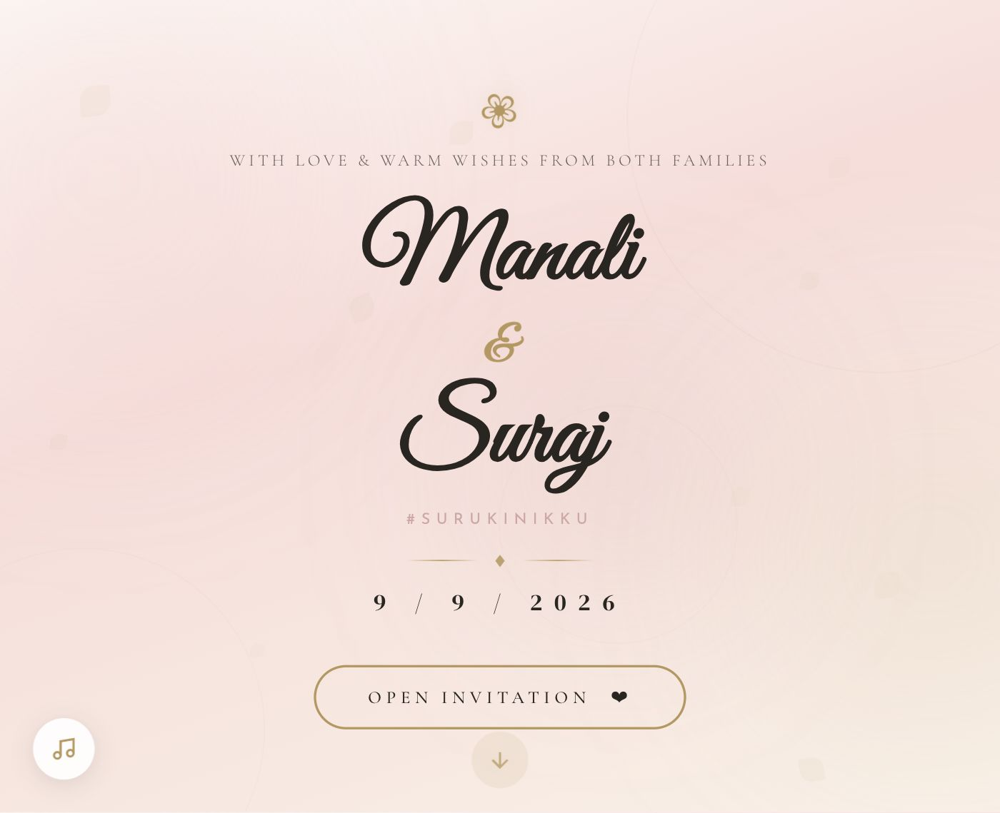
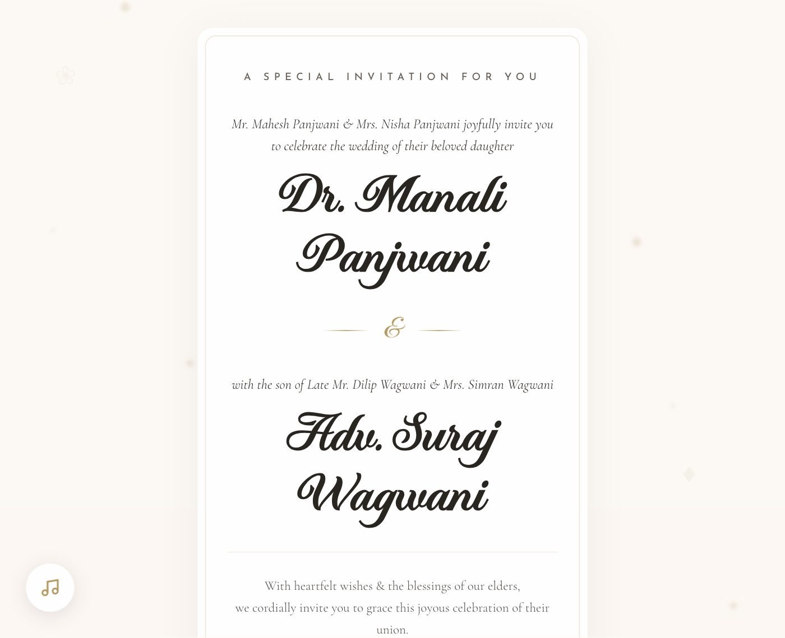
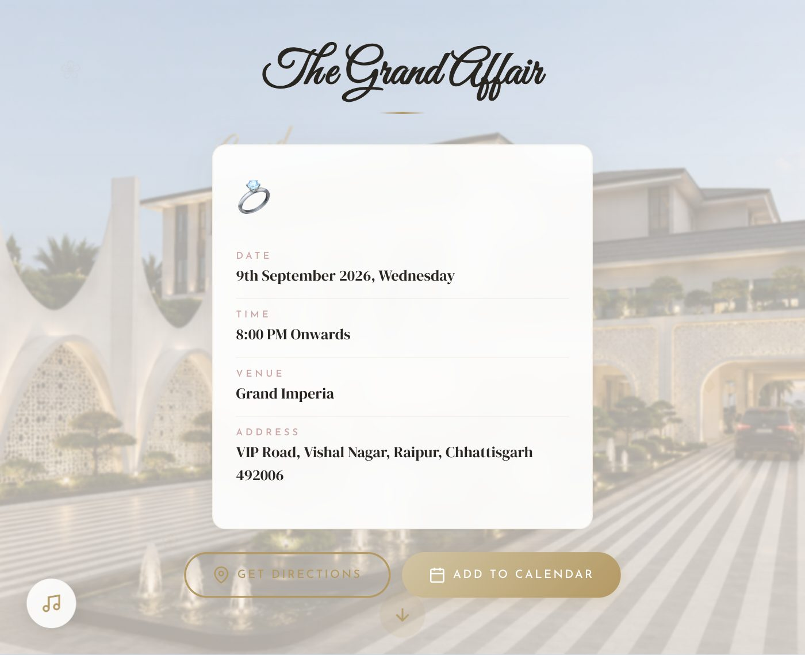
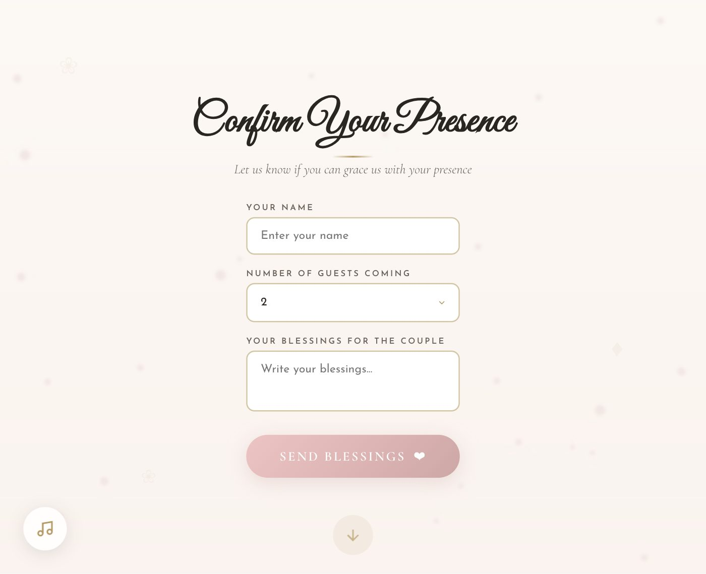
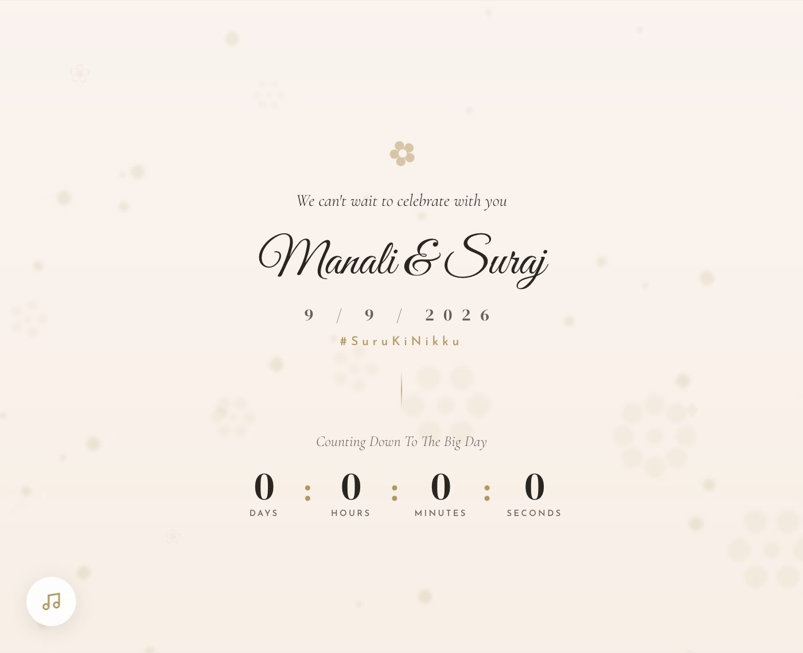

# Wedding Invitation Website — #SuruKiNikku

A dependency-free, single-page wedding invitation built with semantic **HTML5**, modern **CSS3** and **vanilla JavaScript**. The focus of the project is front-end implementation: CSS scroll-snap section storytelling, `IntersectionObserver`-driven reveal animations, a live countdown, procedural confetti/petal effects, `.ics` calendar export and a third-party RSVP endpoint — with no framework, no bundler and no runtime dependencies.

**Status:** Complete and deployed to production. Static site — the repository *is* the build artefact.

**Live site:** https://surukinikku.vercel.app/

> Event names, dates, venue details and photography in this repository are the live content of the deployed invitation.

---

## Screenshots

| Landing | Formal invitation |
| --- | --- |
|  |  |

| Venue & RSVP | Countdown |
| --- | --- |
|  |  |



---

## Purpose

- Serve a production invitation that guests can open on any device from a shared link.
- Demonstrate front-end engineering on a real, deployed project: state handling without a framework, scroll-driven animation, layout resilience and asset/typography optimisation.

## Key frontend features

- **Eight snap-scrolling sections** inside a single scroll container with `scroll-snap-type: y mandatory`.
- **Two-stage intro**: branded loader → animated envelope overlay → smooth scroll into the invitation; the "Open Invitation" button switches to plain navigation after first use.
- **Reveal-on-scroll** via `IntersectionObserver` (sections and individual story lines at different thresholds).
- **Live countdown** ticking every second against a fixed target, with a defined zero state after the target passes.
- **`.ics` calendar export** generated client-side with `Blob` + `URL.createObjectURL`, no server round trip.
- **RSVP form** posted to a Formspree endpoint with `FormData` + `fetch`, optimistic confirmation UI and a failure path.
- **Audio control** with user-gesture-gated autoplay, play/pause state and visual feedback.
- **Procedural effects**: 80-piece confetti burst and continuously spawned petals, both driven by CSS custom properties (`--tx`, `--ty`) so animation stays on the compositor.
- **Open Graph / Twitter card** metadata with a 1200×630 social image for rich link previews.

## Design & UX highlights

- **Design tokens as CSS custom properties** (`:root`) for the palette, gold accents and shadow layers — one place to retune the whole design.
- **Layered backgrounds**: drifting `background-image` layer → tinted `backdrop-filter` overlay → floating ornament layer → frosted content card, each with its own z-index band.
- **Fluid typography** with `clamp()` for every display heading so the type scale interpolates instead of jumping at the breakpoint.
- **Consistent easing**: a shared `cubic-bezier(0.16, 1, 0.3, 1)` curve for entrances, with per-element `transition-delay` staggering (e.g. the date digits reveal at 0.2s / 0.4s / 0.6s).
- **Self-hosted display font** (`fonts/Runethia.otf`, `font-display: swap`) alongside Google Fonts for body/heading faces.

## Responsive behaviour

- Mobile-first presentation with a single breakpoint at `max-width: 480px` that re-tunes padding, card widths, display sizes and button hit areas.
- Fluid `clamp()` type, `vh`-based section height and `-webkit-overflow-scrolling: touch` keep the snap-scroll experience consistent from phone to desktop.
- Full-bleed background layers use negative insets (`inset: -40px`) so parallax drift never exposes an edge on any viewport.

## Animation & interaction highlights

| Technique | Where |
| --- | ---|
| CSS `@keyframes` (18) | loader spin, envelope flap `rotateX`, background drift, orbs, petals, heartbeat, badge/arrow pulses, confetti burst |
| CSS custom-property animations | confetti and sparkle trajectories (`--tx` / `--ty`, `--sx` / `--sy`) |
| `IntersectionObserver` | section reveals, story-line reveals, confetti trigger (+ scroll fallback) |
| 3D transforms & `clip-path` | envelope card lift, flap open, `clip-path: polygon()` flap geometry |
| Backdrop blur | content cards, overlays, music toggle |
| Pointer/state feedback | button fill sweeps, hover lifts, scale-on-active |

## Technology stack

| Layer | Choice |
| --- | --- |
| Markup | Semantic HTML5, single page, no templating |
| Styling | Vanilla CSS3 — custom properties, `clamp()`, scroll-snap, `backdrop-filter`, `clip-path`, keyframes, one media query |
| Logic | Vanilla ES2017+ — `IntersectionObserver`, `fetch`/`FormData`, `Blob`, `Audio`, DOM APIs |
| Typography | Google Fonts (Cormorant Garamond, Josefin Sans, Great Vibes, DM Serif Display) + self-hosted Runethia |
| Form backend | Formspree (hosted endpoint) |
| Hosting | Vercel static build, configured in `vercel.json` |
| Tooling | None required — no `package.json`, no bundler, no dependencies |

## Project structure

```
├── index.html            # Single page: 8 sections + loader + envelope overlay
├── style.css             # Design tokens, layout, animations, breakpoint
├── script.js             # Intro state, observers, countdown, confetti, RSVP, ICS
├── vercel.json           # Static build + cache headers
├── fonts/                # Self-hosted display font
├── assets/               # Backgrounds, illustrations, photography, audio
└── docs/screenshots/     # README captures
```

## Getting started

The project has no dependencies. Any static file server works:

```bash
git clone <repository-url>
cd <repository-folder>

# Option A — Python (pre-installed on macOS)
python3 -m http.server 8000

# Option B — Node
npx serve .
```

Then open http://localhost:8000.

## Development

There is no build or task runner; edit `index.html`, `style.css` or `script.js` and reload the browser.

| Task | Command |
| --- | --- |
| Start a local server | `python3 -m http.server 8000` |
| Syntax-check the JavaScript | `node --check script.js` |
| Validate config | `python3 -m json.tool vercel.json` |

## Build

No build step. The deployed files are the source files; there is nothing to compile, transpile or minify.

## Deployment

Deployed on Vercel as a purely static site. `vercel.json` declares:

- `builds`: `@vercel/static` over `**/*`
- `routes`: all paths served from the project root
- `headers`: `Cache-Control: no-cache` on all responses, so content updates propagate immediately

```bash
vercel            # preview deployment
vercel --prod     # production deployment
```

## Verification

Checks run against this repository on 6 October 2026:

| Check | Result |
| --- | --- |
| `node --check script.js` | Pass |
| `vercel.json` parses as valid JSON | Pass |
| All local references (HTML/CSS/JS) resolve | Pass — 0 missing files |
| Anchor targets vs. element IDs | Pass — 7/7 |
| Tag balance (`<div>`, `<section>`) | Pass — balanced |
| Browser console on load | Pass — 0 errors, 0 warnings |
| Network requests on load | Pass — 0 HTTP errors (21 requests) |
| Lighthouse (local server) | Accessibility **93**, Best Practices **100**, SEO **100** |

The single Lighthouse failure is documented under *Current limitations*.

## Current limitations

- **Countdown target is hardcoded** in `script.js` (and duplicated in the `.ics` payload). The event date has passed, so the counter now renders `0 : 0 : 0 : 0`.
- **Zoom is disabled** (`maximum-scale=1.0, user-scalable=no`) to protect the scroll-snap layout on mobile; this is the one Lighthouse accessibility failure.
- **No `prefers-reduced-motion` handling** — all ambient animation runs regardless of the user's motion preference.
- **No image optimisation**: photography is served as full-resolution PNG/JPEG with no `srcset`, `loading="lazy"` or modern formats; roughly 5 MB of imagery is referenced by the initial HTML.
- **Public, unauthenticated form endpoint** — the RSVP URL ships in the client and can be abused; there is no rate limiting or spam protection.
- **No linting, tests or CI**, and no `package.json`.
- **Event content is duplicated** across `index.html` and `script.js` rather than sourced from a single configuration object.

## Future improvements

- Extract event details into one config object consumed by both markup and calendar export.
- Add `prefers-reduced-motion` to disable or shorten ambient animation.
- Convert imagery to responsive `srcset` + WebP/AVIF and lazy-load below-the-fold sections.
- Add ESLint + HTML validation with a GitHub Actions workflow.
- Move the RSVP submission behind a serverless function with rate limiting and spam filtering.
- Introduce a post-event state (e.g. "The celebration has begun") instead of a zeroed countdown.
- Add a `LICENSE` file once licensing terms are chosen.

## License

No license has been specified for this repository.
